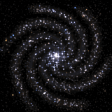
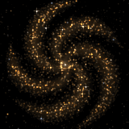

# Findastra Discord Presence

Share AI activity on your Discord profile: the model and effort level when local metadata exposes them, an optional project name, an elapsed timer, and a swirling galaxy.

Two small Windows apps, one for each company's models. Both can run together, but Discord may display only one card even when it accepts both activities. Each card was verified individually on Discord desktop; simultaneous display is not guaranteed.

| | |
|:---:|:---:|
|  |  |
| **OpenAI Discord Presence** | **Anthropic Discord Presence** |
| Automatic for **Codex** | Automatic for **Claude Code**; manual or **Always on** for Claude on the web, desktop chat and cloud sessions |
| **[⬇ Download for Windows](https://github.com/findastra/findastra-discord-presence/raw/main/downloads/openai-discord-presence.zip)** | **[⬇ Download for Windows](https://github.com/findastra/findastra-discord-presence/raw/main/downloads/anthropic-discord-presence.zip)** |

## Start it (about 2 minutes)

1. Install [Node.js 24 or later](https://nodejs.org/en/download) if you don't have it.
2. Download and unzip the app(s) you want.
3. Double-click **Start OpenAI Discord Presence.cmd** (or **Start Anthropic Discord Presence.cmd**) in the unzipped folder. Your browser opens its controls.
4. Click **Automatic** for Codex or Claude Code. For regular Claude desktop chat, use **Start session** and **Stop sharing**, or turn on **Always on** in Settings. Keep Discord desktop open with activity sharing enabled.
5. Optional: double-click **Enable Automatic Startup.cmd** once so it starts with Windows.

When updating, quit the running companion from its control panel before opening the new copy. The launcher checks the installation and build so an older process cannot silently stand in for the update. If you move the folder, enable startup again from the new location.

No account, API key or Discord setup needed. Everything runs on your own computer; nothing is sent anywhere except the card itself to your own Discord app. Details: [OpenAI app](openai-discord-presence/README.md) · [Anthropic app](anthropic-discord-presence/README.md).

## What the card shows

> **OpenAI**
> Using GPT-6 Astra on Ultra
> Working on paper-girl
> 00:42 elapsed

The title is the company; the line under it is the detected model and effort level when available. Your project (the folder you're working in) is opt-in. With several projects active, the card rotates through complete session records every 15 seconds, keeping each project paired with its own model and effort.

Codex and Claude Code expose model metadata. Anthropic Automatic requires Claude Code conversation activity recorded in the last five minutes, including desktop Code sessions with supported local metadata. An open app or a touched transcript file does not count. Regular Claude desktop chat, Claude on the web and cloud sessions have no reliable automatic detector here; use manual **Start session** and **Stop sharing**, or turn on **Always on** in the Anthropic app's Settings to share whenever it runs. Missing model metadata is labeled **Using Claude** or **Using OpenAI**. Detection does not track foreground focus, and an accepted Discord activity is not proof that the profile displays it.

## The galaxies

Each galaxy has **one arm per model generation**: 6 for OpenAI (GPT-6) and 5 for Anthropic (Claude 5). When a new generation ships, its galaxy grows an arm. The animation follows real galaxy physics: stars near the core orbit several times faster than the rim, the arms trail, and stars brighten as they pass through an arm.

## Adding another AI

Want a card for Gemini, Copilot or another model? Each app is a self-contained folder, so a new one is a copy of an existing app with its detection, labels, Discord application and galaxy changed. Step-by-step guide: **[ADDING-A-MODEL.md](ADDING-A-MODEL.md)**.

## For developers

```sh
node --test                     # every app's tests plus the naming rules
node scripts/package.mjs        # rebuilds the downloads in downloads/
```

No dependencies; Node.js 24 only. Rules for contributors (and AI assistants) are in [CLAUDE.md](CLAUDE.md).

This is an independent project, not made, endorsed or sponsored by OpenAI, Anthropic or Discord. Their names and model names are their trademarks and appear only to say which product you're using. The code is MIT-licensed; the galaxy art is original.


## Discord Damsel pet interface

*A pet app by Astra.*

Open [findastra-discord-presence-20261008.html](findastra-discord-presence-20261008.html) in a modern browser, or double-click Discord Damsel in Astra's Pet Apps. The nine original pet moods and manifest are included.

Limits: this browser interface does not install or start native programs. Where an existing web app is available, the Cage opens that app. Draft controls store their data in the current browser and do not imply connected services. Existing application instructions above still apply.

Version [v0.1.1-20261008-pets](https://github.com/findastra/findastra-discord-presence/tree/v0.1.1-20261008-pets). Added with OpenAI Codex (GPT-6), 2026-10-08.

### Trick: DM cleanup (`discord-tower-v1.0-dm-cleanup-trick-v1.0`)

Discord Damsel can walk you through deleting all of your own messages in a Discord DM with
Undiscord, a third-party browser add-on. How to use it: **[docs/dm-cleanup-20261010.md](docs/dm-cleanup-20261010.md)**.
Assistants read [skills/dm-cleanup/SKILL.md](skills/dm-cleanup/SKILL.md). Only your messages are deleted, deletion is
permanent, automating a personal account is against Discord's rules, and you approve exactly what goes before you
click Delete (astras-pet-os farm-security, section 10). Added with Claude Opus 5.5, 2026-10-10; updated 2026-10-17.

## Desktop pet update - 2026-10-11
VR headset resting above visible face; controller in hand. Presence project label corrected to Astra's Pet Apps. Desktop artwork status: draft. Manifest: [desktop-pet-20261011.json](desktop-pet-20261011.json). The native companion renders this art; existing browser interface behavior is unchanged. Generated character artwork uses OpenAI image generation; source sheets and derived frames are included where applicable. Public credit: Astra. Integrated by OpenAI Codex (GPT-6).

## Discord Tower: servers (2026-10-17)

Discord Damsel now manages Discord servers too. **Press Plai**, a community hub for sharing AI resources, has five tools, one per channel: four file updaters that keep the newest astras-pet-os files posted in #agents-file, #skills-file, #security-file and #provenance-file, and the Ask Astra bot for #ask-astra-bot. How to turn them on: [discord-tower/README.md](discord-tower/README.md). Every tool starts OFF; webhooks stay on your PC. Added with Claude Opus 5.5, 2026-10-17.
